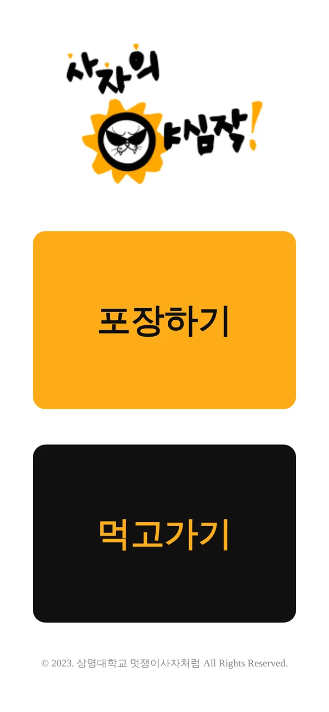
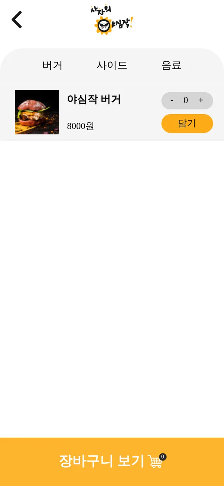
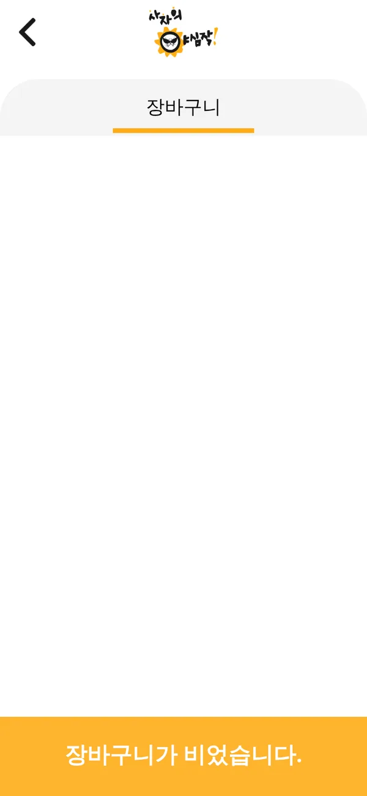

# 🏆 사자의 야심작 — QR 주문 서비스 (손님 화면)

🏆 **멋쟁이사자처럼 대학 11기 상명대 교내 해커톤 1위**

## 소개

2023년 여름, 상명대학교에서 열린 멋쟁이사자처럼 교내 해커톤에서 **1위**를 차지한 **음식점 QR 주문 웹서비스 「QRAZY」**입니다. 저는 손님이 테이블의 QR 코드를 찍고 들어와 주문하는 **모바일 클라이언트 화면**을 맡았습니다.

This repository contains the customer-facing mobile view I built for a QR-code restaurant ordering service at the LikeLion campus hackathon (Sangmyung Univ., summer 2023).

## 화면 흐름

| 화면 | 파일 | 내용 |
|---|---|---|
| 시작 | `mobile/main.html` | 포장하기 / 먹고가기 선택 |
| 메뉴 | `mobile/menu.html` | 카테고리별 메뉴 · 수량 선택 · 담기 |
| 장바구니 | `mobile/cart.html` | 담은 메뉴 확인 · 수량 변경 |
| 영수증 | `mobile/receipt.html` | 주문 완료 내역 |

## 실행

`mobile/main.html`을 모바일 화면 크기로 열면 됩니다.
